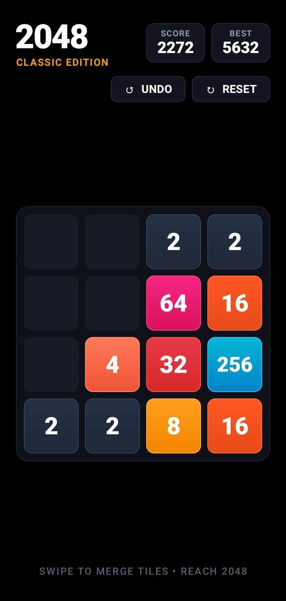
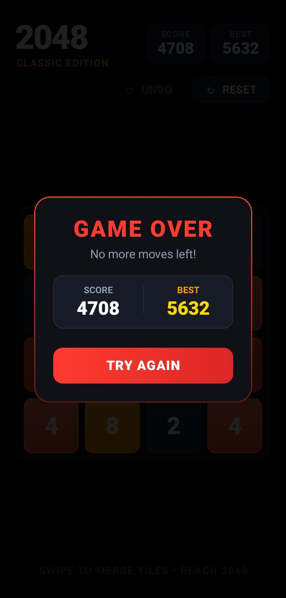

<div align="center">

# 🎮 2048 • Classic Edition
### *A Modern, High-Performance Native Android 2048 Game Built with Jetpack Compose*

[](https://www.android.com/)
[](https://kotlinlang.org/)
[](https://developer.android.com/jetpack/compose)
[](https://github.com/MustafijRatul/2048/releases)
[](LICENSE)

<br/>

<p align="center">
  
  &nbsp;&nbsp;&nbsp;&nbsp;
  
</p>

</div>

---

## 🌟 Highlights

**2048 • Classic Edition** is a ground-up re-imagination of the legendary puzzle game designed specifically for modern Android smartphones. Crafted with **100% Native Jetpack Compose**, it offers true OLED pure-black elegance, buttery-smooth tile motion, and immersive audio-haptic feedback.

- 🖤 **Pure OLED Black (#000000)**: True black AMOLED background with zero battery waste and maximum contrast.
- 🌈 **Vibrant Jewel-Tone Tiles**: Rich, eye-catching color gradients crafted to pop against deep black screens.
- 🚀 **120 FPS Card Swipe Animation**: Buttery-smooth coordinate-based sliding transitions and spring bounce merge animations.
- 🔊 **Tactile Sound & Haptic Engine**: Zero-latency native `SoundPool` audio paired with multi-level haptic pulses on every swipe, merge, and victory.
- ↺ **Top-Bar Undo & Reset**: Effortlessly reverse up to 10 moves or reset without interrupting board flow.
- 🏆 **Score & Best Score Tracker**: Instant persistence of your personal all-time best record.
- 🎬 **Cinematic Studio Intro**: 100% Native GPU Canvas intro sequence with instant tap-to-skip.

---

## 📱 Screenshots

| Gameplay Board | Game Over Screen |
|:---:|:---:|
|  |  |
| *Vibrant AMOLED tiles with centered board layout* | *Crimson Red accented Game Over modal with instant undo* |

---

## 📥 Download APK

Get the latest build directly from the GitHub Releases page:

👉 **[Download 2048 v1.0.0 APK](https://github.com/MustafijRatul/2048/releases/latest)**

*Compatibility: Android 7.0 (Nougat, API 24) and higher.*

---

## 🛠️ Architecture & Tech Stack

```
com.codestitcher.game2048
├── MainActivity.kt               # Edge-to-edge window configuration & entry point
├── game
│   ├── GameColors.kt             # AMOLED color palettes, tile gradients & theme tokens
│   └── GameEngine.kt             # Tile entity model, matrix sliding logic & undo stack
├── ui
│   └── screens
│       ├── GameScreen.kt         # Jetpack Compose UI with animated coordinate transitions
│       └── SplashScreen.kt       # 120 FPS GPU Canvas vector studio intro
└── utils
    └── SoundHapticHelper.kt      # SoundPool audio playback & system vibrator haptics
```

- **UI Framework:** [Jetpack Compose](https://developer.android.com/jetpack/compose) with Material 3
- **Animations:** Compose Animation API (`animateDpAsState`, `Animatable`, `spring`, `FastOutSlowInEasing`)
- **Sound Engine:** Android `SoundPool` for ultra-low latency acoustic response
- **Haptics:** Android `VibrationEffect` & `Vibrator` API
- **Build System:** Gradle 8.7 (Kotlin DSL)
- **Minimum SDK:** Android 7.0 (API Level 24)
- **Target SDK:** Android 14 (API Level 34)

---

## 💻 Building from Source

### Prerequisites
- **Android Studio Jellyfish | 2023.3.1** or newer
- **JDK 17** or **JDK 21**
- **Android SDK Platform 34**

### Steps
1. Clone the repository:
   ```bash
   git clone https://github.com/MustafijRatul/2048.git
   cd 2048
   ```
2. Open the project in Android Studio or build via CLI:
   ```bash
   # On Windows
   .\gradlew.bat assembleDebug

   # On macOS / Linux
   ./gradlew assembleDebug
   ```
3. The compiled APK will be generated at:
   ```
   app/build/outputs/apk/debug/app-debug.apk
   ```

---

## 📄 License

This project is licensed under the **MIT License** — see the [LICENSE](LICENSE) file for details.

---

<div align="center">
  <sub>Crafted with passion for minimalist mobile gaming.</sub>
</div>
